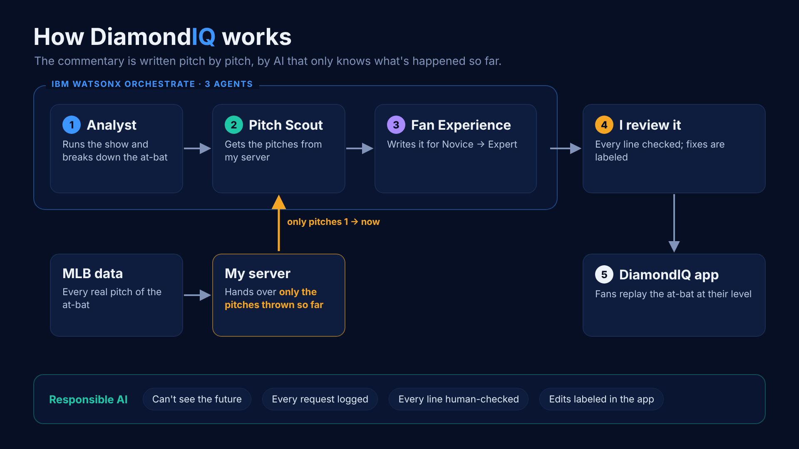

# DiamondIQ

**Every at-bat, explained at your level.**

Every at-bat is a duel between pitcher and hitter, but from the stands you can't tell where a pitch landed, what it was, or why it worked. DiamondIQ replays a real MLB at-bat pitch by pitch on a strike zone, with AI commentary written by three IBM watsonx Orchestrate agents at four knowledge levels: Novice, Learning, Regular and Expert. The agents only ever see the pitches thrown so far, so the commentary stays in the moment.

Built for the IBM SkillsBuild AI Experiential Learning Lab hackathon.

- **Live prototype:** https://diamondiq-demo.netlify.app
- **Demo video:** _add YouTube link_ 
- **Backend repo:** https://github.com/patrickfals/diamondiq-api



## What it does

- **Pitch-by-pitch replay** of a real at-bat (Trevor Story vs. Michael Soroka, 10 pitches) on a true-proportion strike zone, with the count, pitch types and speeds.
- **Four knowledge levels.** The commentary changes, and so do the side rails: Novice gets plain-language pitch names and a legend; Expert gets exact velocities, the pitcher's arsenal and two-strike fouls.
- **Spoiler-safe.** The outcome stays hidden until the final pitch.
- **"How it was made."** For each line of commentary, the app shows the agent steps, what the AI was allowed to see, and the run ID.
- **Hold to pause.** Touch the commentary or the level tabs to pause the replay; release to continue.

## How the AI works

1. **DiamondIQ Analyst** (lead agent) gets the pitch position and a signed snapshot token.
2. **Pitch Scout** redeems the token through our FastAPI backend (`POST /snapshot/redeem`), which returns **only pitches 1–N**. The backend enforces this, not the prompt.
3. **Fan Experience** writes four versions of the commentary, one per level.

I generated the commentary for all 10 pitch positions ahead of time, and each run is correlated with the server's redemption log. That trace is what "How it was made" displays.

## Responsible AI

- **Data minimization:** the AI never receives future pitches or the result.
- **Verifiable:** every snapshot redemption is logged on the server with a run ID.
- **Human in the loop:** I reviewed all 40 commentary lines. 18 were corrected and are labeled "Edited by a human" in the app. The original model text is preserved in the data file.
- **Transparent:** the trace is labeled partial, because steps inside Orchestrate aren't observable from outside.

## Tech stack

- Expo / React Native / TypeScript (iOS, Android, web)
- IBM watsonx Orchestrate (3 agents)
- FastAPI backend on Render
- IBM Bob, used to build the app: see [`bob_sessions/`](bob_sessions/)
- Netlify, hosting the web build

## Run it locally

```bash
npm install
npx expo start          # scan the QR code with Expo Go, or press w for web
```

Web build:

```bash
npx expo export --platform web   # outputs dist/
```

The app reads pitch data from the deployed backend (https://diamondiq-api.onrender.com). On the free tier, the first load can take a few seconds while the server wakes up.

## Project structure

```
src/
  screens/AtBatScreen.tsx       main screen
  components/HeroCard.tsx       scoreboard, strike zone, level-aware side rails, agent trace
  components/StrikeZone.tsx     true-proportion zone with tappable markers
  components/CommentarySection.tsx
  hooks/useReplayEngine.ts      pitch-by-pitch replay state
  data/                         pre-generated commentary + agent trace
bob_sessions/                   IBM Bob task reports and screenshots
```

## Data

MLB data is used for non-commercial, educational purposes.
